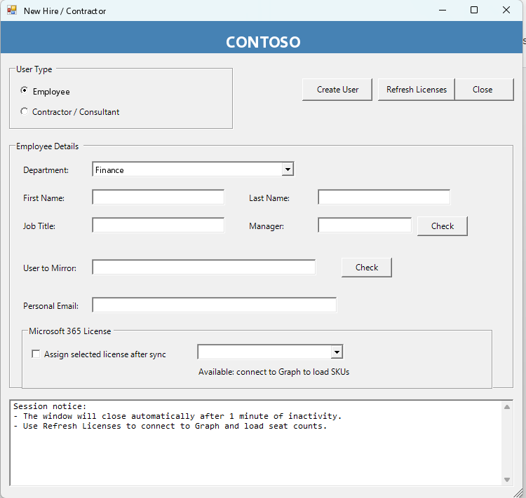

# New Hire / Contractor Onboarding GUI

WinForms PowerShell tool that provisions employees and contractors in a hybrid Active Directory + Microsoft 365 environment, with optional group mirroring from a peer account and Graph-based license assignment.

## What it does

- Creates AD user accounts (employee or contractor flows)
- Sets UPN, primary SMTP, proxyAddresses, and manager
- Places the user in a department OU from **config-driven** dropdown (6 Contoso examples)
- Mirrors security-group membership from a chosen peer, with an admin-group picker
- Connects to Microsoft Graph (interactive) to assign available licenses
- Generates a random temporary password and logs the run

## Requirements

- Windows with **RSAT: Active Directory** module
- PowerShell 5.1+ (WinForms)
- Rights to create users / modify groups in the target OUs
- Microsoft Graph PowerShell SDK (license assignment) + appropriate Graph roles
- Domain-joined admin workstation (or secure jump host)

## Configuration

Edit `$script:OrgConfig` at the top of `New-Hire-Onboarding-GUI.ps1` (see `config.example.psd1`).

| Key | Example |
|-----|---------|
| `AdDomain` / `PrimaryMailDomain` | `contoso.com` |
| `ContractorMailDomain` | `contractors.contoso.com` |
| `Departments` | Ordered hashtable — **keys = dropdown items**, values hold `Path` OU |
| `ContractorO365Group` / `ContractorsGroup` | AD group names for contractor flow |

Add or remove departments by editing `Departments` only — the dropdown loads the keys.

## Usage

```powershell
Set-ExecutionPolicy -Scope Process Bypass
.\New-Hire-Onboarding-GUI.ps1
```

Choose Employee or Contractor, fill identity fields, resolve manager + mirror user, then Create.

## Safety notes

- Creates live AD objects on Create — no `-WhatIf` on the GUI path.
- Test against a lab OU first; confirm department OU paths in config.
- Temporary passwords appear in the output pane and transcript — treat logs as sensitive.
- No API tokens in the script (Graph uses interactive sign-in).

## Screenshot


