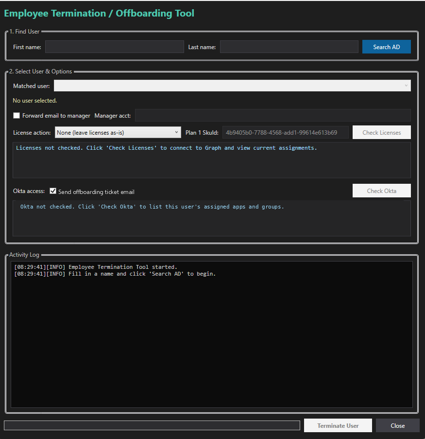

# Employee Termination / Offboarding GUI

WPF PowerShell tool that runs a multi-step offboarding workflow against hybrid AD, Exchange Online / Microsoft 365, and Okta.

## What it does

1. Look up the user in AD
2. Reset password / disable / move to Disabled OU
3. Export and strip group memberships (optional journal/retention group)
4. Hide from address lists / mailbox handling as configured
5. Remove Microsoft 365 licenses via Graph
6. Deactivate Okta user and remove Okta group assignments
7. Optionally send a plain **offboarding ticket email** (disabled by default)
8. Trigger AD replication (`repadmin`) against the configured DC

## Requirements

- Windows, PowerShell 5.1+, WPF assemblies
- **ActiveDirectory** module (RSAT)
- Graph modules / scopes listed in config
- Okta API token via **`OKTA_API_TOKEN`** env var (preferred) or optional token file
- Admin rights on AD + appropriate M365 / Okta roles

## Configuration

Edit `$script:Config` (see `config.example.psd1`).

| Key | Notes |
|-----|-------|
| `OktaDomain` | `https://YOUR_ORG.okta.com` |
| `DisabledUsersOU` | `OU=Disabled Users,DC=contoso,DC=com` |
| `TicketEmail.Enabled` | **`$false` by default** — set `$true` to allow the GUI checkbox |
| `TicketEmail.To` / `From` / `SmtpServer` | Contoso placeholders |
| `GraphScopes` | Single shared scope list for Graph connect |

**Never commit a real Okta token.**

## Usage

```powershell
$env:OKTA_API_TOKEN = '<from password manager>'
.\Employee-Termination-GUI.ps1
```

Search for the user, optionally Check Okta / Check Licenses, tick steps, then Terminate.

## Safety notes

- Steps are **destructive**. No global `-WhatIf` on the GUI.
- Use a lab account first. Export group memberships before stripping.
- License SKU GUIDs in the map are Microsoft's public product IDs.

## Screenshot


