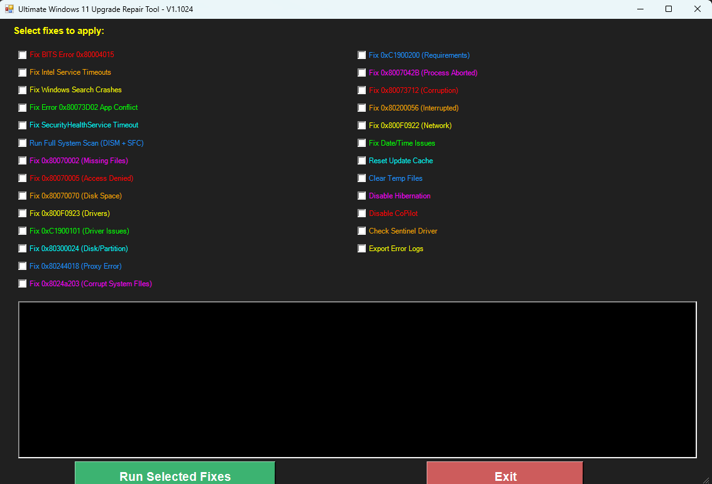

# Windows 11 Upgrade Repair Tool

WinForms PowerShell utility that runs a checklist of common Windows 10→11 upgrade blockers (BITS, Windows Update cache, search, disk space, known HRESULT fixes) with logging, optional registry backup, and a system health report.

## What it does

- Elevates to Administrator if needed
- Optional registry backup before invasive fixes
- Pre-flight OS / network checks
- Selectable repairs (BITS, Intel service timeouts, Windows Search, Store / AppX, Windows Update reset, temp cleanup, hibernation, Copilot policy, and several documented upgrade HRESULTs)
- Exports recent Windows Update / BITS events to CSV
- Writes a text health report under the script folder

## Requirements

- Windows 10/11 client
- PowerShell 5.1+ (WinForms)
- Local Administrator
- Optional: reachable UNC share if you set `LogExportDir`

## Configuration

Edit `$script:Config` at the top of `Fix-Windows11Upgrade.ps1` (see `config.example.psd1`).

| Key | Example |
|-----|---------|
| `LogSubdir` / `ReportSubdir` / `BackupSubdir` | Folders created next to the script |
| `LogExportDir` | Empty (default) = local logs only; or a Contoso file-share UNC |

## Usage

```powershell
Set-ExecutionPolicy -Scope Process Bypass
.\Fix-Windows11Upgrade.ps1
```

Check the fixes you need, then Run. Restart before retrying the upgrade.

## Safety notes

- Many fixes mutate services, AppX packages, and update caches — test on a lab image first.
- `LogExportDir` defaults to **local** so the portfolio copy does not touch a remote share.
- Treat exported event CSVs and the operation log as sensitive.

## Screenshot


