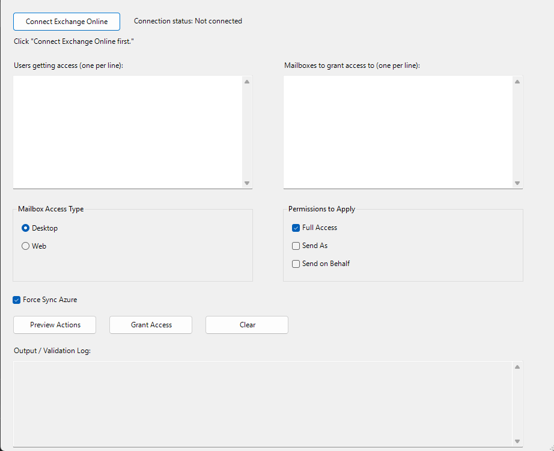

# Mailbox Access GUI

WinForms tool that grants Exchange Online mailbox permissions (Full Access with desktop/web automapping, Send As, Send on Behalf) for one or more users across one or more mailboxes, with preview and optional Azure AD Connect delta sync.

## What it does

- Connects to Exchange Online (interactive, with device-code fallback)
- Resolves requestors and mailboxes (alias → `@contoso.com` when no `@` is given)
- Applies selected permissions with a confirmation prompt
- Optionally triggers `Start-ADSyncSyncCycle -PolicyType Delta` on a configured sync server

## Requirements

- PowerShell 5.1+ (WinForms)
- `ExchangeOnlineManagement` module (auto-install CurrentUser attempted)
- Exchange admin roles for mailbox / recipient permissions
- WinRM to `AzureSyncServer` if using Force Sync

## Configuration

Edit `$script:Config` in `MailboxAccess_GUI.ps1` (see `config.example.psd1`).

| Key | Example |
|-----|---------|
| `PrimaryMailDomain` | `contoso.com` |
| `AzureSyncServer` | `AADSYNC01` |
| `ForceSyncDefault` | `$false` (portfolio safe default) |

## Usage

```powershell
Set-ExecutionPolicy -Scope Process Bypass
.\MailboxAccess_GUI.ps1
```

Connect → enter users and mailboxes → Preview → Grant Access.

## Safety notes

- Live permission changes — use Preview and a test mailbox first.
- Force Sync defaults **off** so a casual run does not kick production AAD Connect.
- No secrets in the script (interactive EXO sign-in).

## Screenshot


